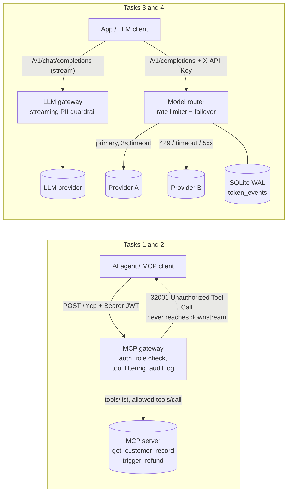

# AI Gateway Assessment

Four small, fully tested components that sit between AI agents/LLM clients and the systems they call:

| Task | What it is | Folder |
|---|---|---|
| 1 | MCP server (stdio) with strict input validation and spec-correct error codes | `task1_mcp_server/` |
| 2 | MCP security gateway: JWT auth + tool-level authorisation in front of an MCP server | `task2_mcp_gateway/` |
| 3 | LLM gateway that redacts PII (email, SSN, card) from a streaming response in flight | `task3_llm_guardrail/` |
| 4 | LLM gateway router: token-aware sliding-window rate limit (SQLite) + primary/secondary failover | `task4_model_router/` |

Every upstream is mocked, so the whole suite runs offline. Each task folder has a `NOTES.md` (design decisions, limitations, interview Q&A); `INTERVIEW_PREP.md` has the end-to-end talk track.

## Architecture



In a real deployment the two LLM gateway functions (guardrail and router) would be chained in one gateway; here they are separate so each can be tested and explained alone.

## Setup

Python 3.11+ (developed on 3.14).

```bash
python -m venv .venv
.venv/Scripts/python -m pip install -e ".[dev]"      # Windows
# .venv/bin/python -m pip install -e ".[dev]"        # macOS / Linux
```

Exact versions are pinned in `pyproject.toml`; the full freeze is in `requirements.lock.txt`.
Copy `.env.example` to `.env` for the variables used below.

## Quickest way to run everything (Windows PowerShell)

```powershell
.\start.ps1    # starts all 7 services in the background, logs in .run\
.\demo.ps1     # MCP gateway deny/allow, streaming redaction, rate limit and failover
.\stop.ps1     # stops everything
```
If PowerShell blocks the scripts, run once: `Set-ExecutionPolicy -Scope CurrentUser RemoteSigned`.
## Run each task

**Task 1: MCP server (stdio)**
```bash
python -m task1_mcp_server.server
npx @modelcontextprotocol/inspector python -m task1_mcp_server.server   # try it by hand
```

**Task 2: MCP gateway** (three terminals; `JWT_SECRET` must be at least 32 characters)
```bash
python -m uvicorn task2_mcp_gateway.mock_downstream:app --port 9001
JWT_SECRET=... DOWNSTREAM_URL=http://127.0.0.1:9001/mcp python -m task2_mcp_gateway.app   # :9000
JWT_SECRET=... python -m task2_mcp_gateway.mint_token --role viewer        # prints a token
curl -X POST localhost:9000/mcp -H "Authorization: Bearer <token>" -H "Content-Type: application/json" \
  -d '{"jsonrpc":"2.0","id":1,"method":"tools/call","params":{"name":"admin_reset_key"}}'
```

**Task 3: streaming PII guardrail**
```bash
python -m task3_llm_guardrail.mock_llm        # :9101
python -m task3_llm_guardrail.app             # :9100
curl -N -X POST localhost:9100/v1/chat/completions -H "Content-Type: application/json" \
  -d '{"model":"m","messages":[{"role":"user","content":"hi"}],"stream":true}'
make bench                                    # TTFT / latency, direct vs gateway
```
Real provider: set `UPSTREAM_URL` and `UPSTREAM_API_KEY` (off by default).

**Task 4: rate limiter and router**
```bash
python -m uvicorn task4_model_router.mock_providers:primary_app --port 9301
python -m uvicorn task4_model_router.mock_providers:secondary_app --port 9302
python -m task4_model_router.app              # :9300, demo keys demo-key-tenant-a / demo-key-tenant-b
curl -X POST localhost:9300/v1/completions -H "X-API-Key: demo-key-tenant-a" \
  -H "Content-Type: application/json" -d '{"prompt":"hello","max_tokens":100}'
curl -X POST localhost:9301/_mode -H "Content-Type: application/json" -d '{"mode":"slow"}'   # force failover
```

**Everything at once (Docker):** `JWT_SECRET=<32+ chars> docker compose up --build` starts all seven services.
(The Docker files were written but could not be run on the machine used to build this repo.)

## Tests and lint

```bash
make test            # all tasks (pytest, asyncio auto mode)
make test-task1      # ... through make test-task4
make lint            # ruff (T201 forbids print) + mypy
```
Without `make` (for example on Windows), run `python -m pytest` and `python -m ruff check . && python -m mypy common task1_mcp_server task2_mcp_gateway task3_llm_guardrail task4_model_router`.

## Design decisions in one place

- **Protocol errors vs business errors (Task 1).** Bad arguments and unknown tools are JSON-RPC `-32602`; "not found" or "insufficient balance" are `isError` tool results. The SDK's high-level `MCPServer` turns every exception into `isError`, so the server uses the low-level `Server` with a custom `tools/call` handler.
- **Gateway fails closed (Task 2).** Auth first, then envelope validation, then policy; tool names are Unicode-normalised before the `admin_` check; batches are rejected; the token is never forwarded downstream or logged.
- **Bounded hold-back streaming (Task 3).** Only text that could still become a PII match is held (the trailing word or number, capped at the longest possible match), so memory is O(window) and TTFT is barely affected. Streamed output equals whole-text redaction (property tested). Errors drop the held tail instead of leaking a partial match.
- **Reserve, then reconcile (Task 4).** Tokens are reserved before the upstream call and corrected to real usage afterwards; check-and-reserve is atomic (per-tenant lock + `BEGIN IMMEDIATE`). Fail over on 429/408/5xx/timeout/connection/garbage, never on other 4xx.
- **Sanitised errors everywhere.** One schema, `{"error": {"type","code","message","request_id"}}`; internals go to stderr logs with the request id, never to clients.
- **Mutation-checked tests.** The bypass, disconnect and concurrency tests were each shown to fail when the protection they guard is removed.

## Layout

```
common/                 stderr logging with request_id, standard error schema
task1_mcp_server/       server.py models.py data.py tests/ NOTES.md
task2_mcp_gateway/      app.py auth.py jsonrpc.py mock_downstream.py mint_token.py tests/ NOTES.md
task3_llm_guardrail/    app.py redactor.py sse.py mock_llm.py bench_ttft.py tests/ NOTES.md
task4_model_router/     app.py rate_limiter.py router.py providers.py db.py tokens.py mock_providers.py tests/ NOTES.md
```
